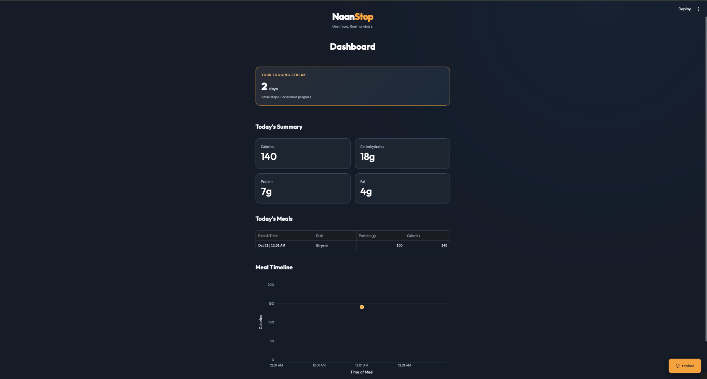
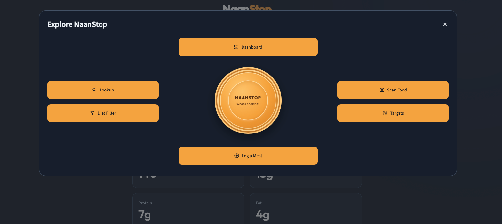
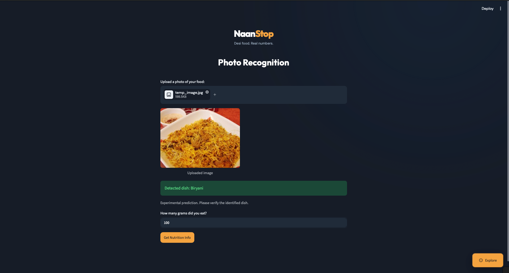

# 🍛 NaanStop

**Desi food. Real numbers.**

NaanStop is a South Asian nutrition-tracking web application built with Python and Streamlit. It helps users explore nutritional information for South Asian dishes, estimate calories and macronutrients based on portion sizes, log meals, and track their daily intake.

The application also includes an experimental food image classification feature powered by PyTorch.

**Project Status:** Minimum Viable Product (MVP)

**Live Demo:** [Try NaanStop](YOUR_STREAMLIT_APP_URL)

## Features

### Nutrition Lookup
Search for supported South Asian dishes and calculate estimated calories, protein, carbohydrates, and fat based on serving size.

### AI-Powered Food Recognition
Upload a food photograph and use a PyTorch-based image classification model to predict the dish. Predictions are experimental and should be verified by the user.

### Meal Logging
Record meals and portion sizes, then view estimated nutritional intake.

### Nutrition Dashboard
View daily calorie and macronutrient totals, logged meals, a meal timeline, and logging streaks.

### Dietary Filtering
Explore dishes based on dietary preferences, including halal, vegetarian, vegan, Sikh-friendly, and fasting-friendly options.

### Calorie Target Calculator
Estimate daily calorie requirements using personal measurements and activity level.

### Custom Navigation
Navigate between features using NaanRing, a custom interface built with Streamlit and CSS.

## Tech Stack

| Technology | Purpose |
|---|---|
| Python | Application logic and data processing |
| Streamlit | Web application framework |
| PyTorch | Food image classification |
| Pandas | Food data and meal-log processing |
| Plotly | Interactive nutrition visualizations |
| CSV | Food dataset and MVP meal storage |
| CSS | Custom interface styling |


## Screenshots

### Dashboard


### NaanRing Navigation


### AI-Powered Food Recognition


## Getting Started

### 1. Clone the repository

```bash
git clone YOUR_GITHUB_REPOSITORY_URL
cd YOUR_REPOSITORY_FOLDER
```

### 2. Create a virtual environment

```bash
python -m venv .venv
```

Activate it on macOS or Linux:

```bash
source .venv/bin/activate
```

Or on Windows:

```bash
.venv\Scripts\activate
```

### 3. Install dependencies

```bash
pip install -r requirements.txt
```

### 4. Run the application

```bash
streamlit run app.py
```

The application will open in your browser.

**Note:** Food recognition requires the trained model weights and any supporting model files used by `predict.py`. Make sure these are available before testing that feature.

## Project Structure

```text
NaanStop-app/
├── .streamlit/
│   └── config.toml
├── .gitignore
├── README.md
├── app.py
├── nutrition.py
├── filter.py
├── user_profile.py
├── meal_log.py
├── dashboard.py
├── streak_counter.py
├── predict.py
├── train_model.py
├── test.py
├── food_data.csv
├── meal_log.csv
├── model.pth
├── class_labels.json
└── requirements.txt
```

## Key Files

app.py — Main Streamlit application, including the interface and navigation.

nutrition.py — Calculates nutritional information based on food portions.

filter.py — Filters dishes according to dietary preferences.

user_profile.py — Calculates estimated daily calorie targets.

meal_log.py — Handles meal logging.

dashboard.py — Processes meal data for dashboard summaries.

streak_counter.py — Tracks meal-logging consistency.

predict.py — Uses the trained model to predict food categories from images.

train_model.py — Contains the machine learning training pipeline.

model.pth — Saved PyTorch model weights.

class_labels.json — Maps model predictions to food categories.

food_data.csv — South Asian food nutrition dataset.

meal_log.csv — CSV-based meal records used by the MVP.

test.py — Project test script.

requirements.txt — Python dependencies.

.streamlit/config.toml — Streamlit theme configuration.


Additional model files and training artifacts may be required depending on the deployment configuration.

## Current Limitations

NaanStop is currently an MVP designed to demonstrate its core functionality.

- Meal logging uses CSV-based storage rather than a persistent, user-specific database.
- User authentication and separate accounts have not yet been implemented.
- The supported food database is limited.
- Food image predictions may be inaccurate and require further evaluation.

On hosted deployments, local CSV changes may be temporary and are not suitable for secure, isolated multi-user storage.

## Potential Future Improvements

- Persistent database storage and user authentication
- Expanded South Asian food coverage
- Improved image classification accuracy and model evaluation
- Personalized nutrition history and progress tracking
- Automated testing and more robust deployment workflows

## Disclaimer

Nutritional information and calorie targets are estimates and should not be treated as professional medical or dietary advice.

---

**Built as a personal software development and machine learning portfolio project.**
